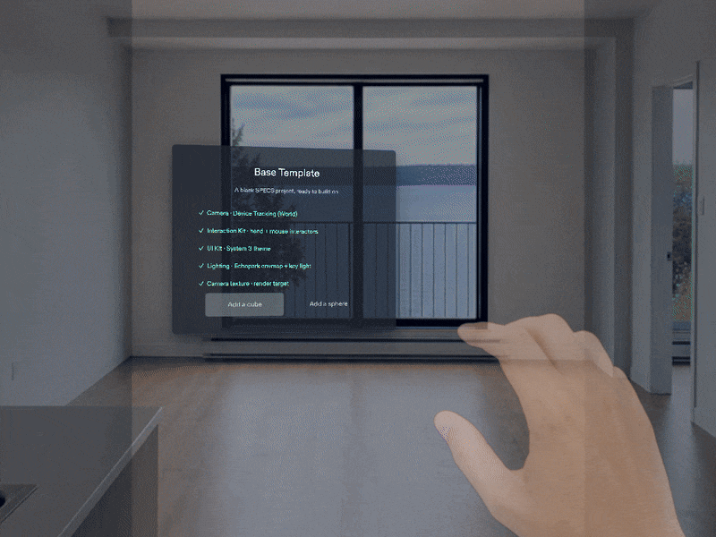

# Base Template

<!-- tags -->
    
<!-- /tags -->

## Overview

Base Template is a minimal, empty SPECS project — a clean slate to start building from. It comes preconfigured with the [Interaction Kit (SIK)](https://developers.snap.com/spectacles/spectacles-frameworks/spectacles-interaction-kit/features/overview) and the UI Kit, a camera texture and render target, and environment lighting, so you can drop in your own objects and scripts without any boilerplate.

> **NOTE:**
> This project will only work for the SPECS platform.

## What's Inside

- **Interaction Kit (SIK)** and **UI Kit** packages, ready to use.
- A preconfigured **Scene** with camera texture, render target, and environment lighting.
- No example content — an intentionally blank starting point.

## Design Guidelines

Designing Lenses for SPECS offers all-new possibilities to rethink user interaction with digital spaces and the physical world.
Get started using our [Design Guidelines](https://developers.snap.com/spectacles/best-practices/design-for-spectacles/introduction-to-spatial-design).

## Prerequisites

- **Lens Studio**: v5.25+

**Note:** Ensure Lens Studio is [compatible with SPECS](https://developers.specs.com) for your SPECS device and OS versions.

- **SPECS OS Version**: v7.0+
- **SPECS App iOS**: v1.7+
- **SPECS App Android**: v1.7+

To update your SPECS device and mobile app, please refer to this [guide](https://developers.specs.com).

You can download the latest version of Lens Studio from [here](https://lensstudio.com).

## Getting Started

To obtain the project folder, clone the repository.

> **IMPORTANT:**
> This project uses Git Large Files Support (LFS). Downloading a zip file using the green button on GitHub **will not work**. You must clone the project with a version of git that has LFS.
> You can download Git LFS [here](https://git-lfs.github.com/).

## Initial Project Setup

The project is pre-configured to get you started without any additional steps. Open `BaseTemplate.esproj` in Lens Studio. If you encounter issues in the Logger Panel, please ensure your Lens Studio environment is set up for [SPECS](https://developers.snap.com/spectacles/get-started/start-buiding/preview-panel).

## Testing the Lens

### In Lens Studio Editor

Use the [Interactive Preview Panel](https://developers.snap.com/lens-studio/lens-studio-workflow/previewing-your-lens#interactive-preview) to preview the scene.

### In SPECS Device

To install your Lens on your device, refer to the guide provided [here](https://developers.snap.com/spectacles/get-started/start-buiding/test-lens-on-spectacles).

## Support

If you have any questions or need assistance, please don't hesitate to reach out. Our community is here to help, and you can connect with us and ask for support [here](https://www.reddit.com/r/Spectacles/). We look forward to hearing from you and are excited to assist you on your journey!

## Contributing

Feel free to provide improvements or suggestions or directly contributing via merge request. By sharing insights, you help everyone else build better Lenses.

---

​

​

​

​

​

---

*Built with 👽 by the SPECS team*
