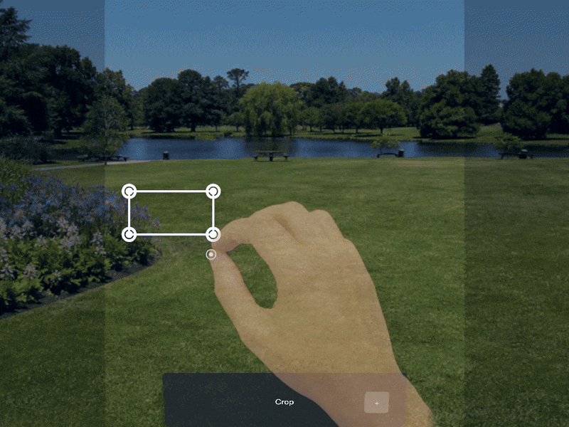

# Crop

<!-- tags -->
    
<!-- /tags -->

## Overview

This sample demonstrates how to "crop" the environment using hand gestures on SPECS. The user pinches both hands close together and pulls the right hand diagonally to define a rectangular capture window in world space, which is then sent to OpenAI's GPT-4o for object identification. It showcases the Camera Module for live camera texture access, world-to-camera-space projection via virtual tracking cameras, and Remote Service Gateway for AI vision requests. Learn more about the [Camera Module API](https://developers.snap.com/spectacles/about-spectacles-features/apis/camera-module).

> **NOTE**: This project will only work for the SPECS platform.

## Design Guidelines

Designing Lenses for SPECS offers all-new possibilities to rethink user interaction with digital spaces and the physical world.
Get started using our [Design Guidelines](https://developers.snap.com/spectacles/best-practices/design-for-spectacles/introduction-to-spatial-design)

## Prerequisites

- **Lens Studio**: v5.24+

**Note:** Ensure Lens Studio is [compatible with SPECS](https://ar.snap.com/download) for your SPECS device and OS versions.

- **SPECS OS Version**: v7.0+
- **SPECS App iOS**: v1.7+
- **SPECS App Android**: v1.7+

To update your SPECS device and mobile app, please refer to this [guide](https://support.spectacles.com/hc/en-us/articles/30214953982740-Updating).

You can download the latest version of Lens Studio from [here](https://ar.snap.com/download?lang=en-US).

The camera feature requires you to use Experimental APIs. Please see Experimental APIs for more details [here](https://developers.snap.com/spectacles/about-spectacles-features/apis/experimental-apis).

Extended Permissions mode on device must be enabled for enabling some of the SPECS APIs. Please see Extended Permissions for more details [here](https://developers.snap.com/spectacles/permission-privacy/extended-permissions).

## Getting Started

To obtain the project folder, clone the repository.

> **IMPORTANT:**
> This project uses Git Large Files Support (LFS). Downloading a zip file using the green button on GitHub **will not work**. You must clone the project with a version of git that has LFS.
> You can download Git LFS [here](https://git-lfs.github.com/).

## Initial Project Setup

The project should be pre-configured to get you started without any additional steps. However, if you encounter issues in the Logger Panel, please ensure your Lens Studio environment is set up for [SPECS](https://developers.snap.com/spectacles/get-started/start-buiding/preview-panel).

To enable the Remote Service Gateway API calls, you need to:

1. Install the Remote Service Gateway Token Generator plug-in from the Asset Browser.
2. Go to **Window > Remote Service Gateway Token**.
3. Click **Generate Token**.
4. Paste the token into the `RemoteServiceGatewayCredentials` object in the Inspector.

Until the Snap token is set, a red-framed **Credentials needed** panel shows before the guide and lists what is missing. Press **Continue without credentials** to dismiss it; GPT-4o captions won't work until the token is set. The panel comes from the `CredentialsWarning` object, which sits right before the `Guide` in the scene and reads `RemoteServiceGatewayCredentials`. Once the token is set, the panel no longer appears and the guide shows directly.

## Key Script

[CameraService.ts](./Assets/Scripts/CameraService.ts) - Initialises the Camera Module, creates the crop texture feed, and sets up virtual tracking cameras used for world-to-screen-space projection.

[CropRegion.ts](./Assets/Scripts/CropRegion.ts) - Projects the four corner scene objects into camera space each frame and updates the crop texture rectangle to match the hand-defined region.

[PictureController.ts](./Assets/Scripts/PictureController.ts) - Detects simultaneous close pinch from both hands and instantiates the scanner prefab that drives the capture workflow.

[CredentialsWarning.ts](./Assets/Scripts/CredentialsWarning/CredentialsWarning.ts) - Shows the red **Credentials needed** panel before the guide while the Snap token isn't set.

[PictureBehavior.ts](./Assets/Scripts/PictureBehavior.ts) - Tracks pinch positions to position the crop boundary corners, captures the cropped image, and sends it to ChatGPT for identification.

[ChatGPT.ts](./Assets/Scripts/ChatGPT.ts) - Encodes the captured texture as base64 and submits it to GPT-4o via the Remote Service Gateway, then returns the AI response.

## Testing the Lens

### In Lens Studio Editor

1. Open the project in Lens Studio and ensure the interactive preview is active.
2. Click anywhere in the preview to trigger the editor test path, which automatically places the crop area in front of the camera and sends a capture to ChatGPT.
3. Check the Logger Panel to see request and response messages from the AI.

### In SPECS Device

1. Install the lens on your SPECS device.
2. Pinch both hands close together to initialise the crop scanner.
3. Keep both pinches held and pull your right hand diagonally downward to size the capture window.
4. Release the pinch on both hands simultaneously to send the cropped image to ChatGPT.
5. The AI caption appears above the crop area with an animated scale-in effect.

## Support

If you have any questions or need assistance, please don't hesitate to reach out. Our community is here to help, and you can connect with us and ask for support [here](https://www.reddit.com/r/Spectacles/). We look forward to hearing from you and are excited to assist you on your journey!

## Contributing

Feel free to provide improvements or suggestions or directly contributing via merge request. By sharing insights, you help everyone else build better Lenses.

---

 

​

​

​

​

​

​

---

*Built with 👽 by the SPECS team*
