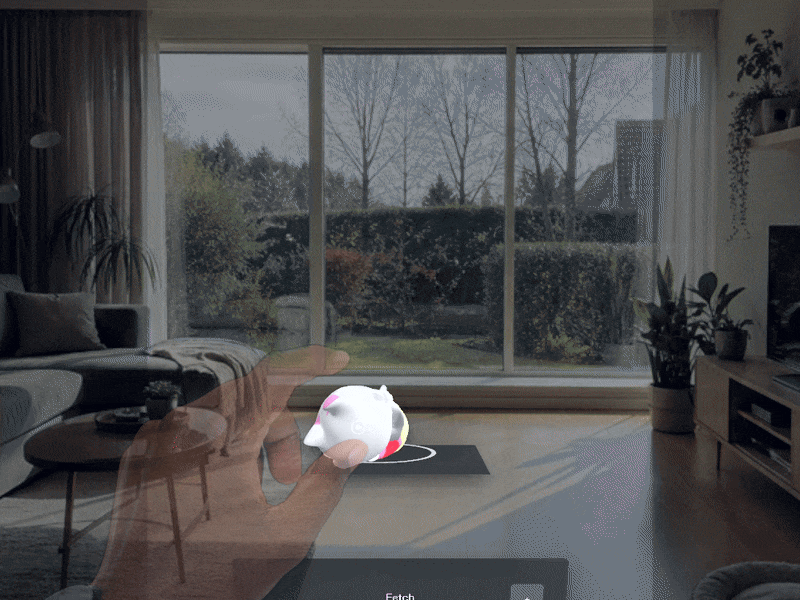

# Fetch

<!-- tags -->
    
<!-- /tags -->

## Overview

This is a sample project which uses the SPECS [Internet Module](https://developers.snap.com/spectacles/about-spectacles-features/apis/internet-access).

> **NOTE**:
> This project will only work for the SPECS platform.

## Design Guidelines

Designing Lenses for SPECS offers all-new possibilities to rethink user interaction with digital spaces and the physical world.
Get started using our [Design Guidelines](https://developers.snap.com/spectacles/best-practices/design-for-spectacles/introduction-to-spatial-design)

## Prerequisites

- **Lens Studio**: v5.25+

**Note:** Ensure Lens Studio is [compatible with SPECS](https://developers.specs.com) for your SPECS device and OS versions.

- **SPECS OS Version**: v7.0+
- **SPECS App iOS**: v1.7+
- **SPECS App Android**: v1.7+

To update your SPECS device and mobile app, please refer to this [guide](https://developers.specs.com).

You can download the latest version of Lens Studio from [here](https://lensstudio.com).

The camera feature requires you to use Experimental APIs. Please see Experimental APIs for more details [here](https://developers.snap.com/spectacles/about-spectacles-features/apis/experimental-apis).

Extended Permissions mode on device must be enabled for enabling some of the SPECS APIs. Please see Extended Permissions for more details [here](https://developers.snap.com/spectacles/permission-privacy/extended-permissions).

## Getting Started

To obtain the project folder, clone the repository.

> **IMPORTANT:**
> This project uses Git Large Files Support (LFS). Downloading a zip file using the green button on GitHub **will not work**. You must clone the project with a version of git that has LFS.
> You can download Git LFS [here](https://git-lfs.github.com/).

## Initial Project Setup

The project should be pre-configured to get you started without any additional steps. However, if you encounter issues in the Logger Panel, please ensure your Lens Studio environment is set up for [SPECS](https://developers.snap.com/spectacles/get-started/start-buiding/preview-panel).

## Key Script

[FetchCatFacts.ts](./Assets/Scripts/FetchCatFacts.ts) - This is the primary script driving the core behavior of this sample project by accessing the [Internet Module](https://developers.snap.com/spectacles/about-spectacles-features/apis/internet-access). The other scripts are supplementary and help build the overall experience.

## Testing the Lens

### In Lens Studio Editor

Locate the cat in the Scene using the [Interactive Preview Panel](https://developers.snap.com/lens-studio/lens-studio-workflow/previewing-your-lens#interactive-preview). Pinch the cat by clicking it with the left mouse button, which simulates a pinch within Lens Studio. Repeat the action to receive a new response from the cat.

### In SPECS Device

To install your Lens on your device, refer to the guide provided [here](https://developers.snap.com/spectacles/get-started/start-buiding/test-lens-on-spectacles).

After successfully installing the Lens, locate the cat in the environment, point at it and pinch. Repeat the action to receive a new response from the cat.

## Support

If you have any questions or need assistance, please don't hesitate to reach out. Our community is here to help, and you can connect with us and ask for support [here](https://www.reddit.com/r/Spectacles/). We look forward to hearing from you and are excited to assist you on your journey!

## Contributing

Feel free to provide improvements or suggestions or directly contributing via merge request. By sharing insights, you help everyone else build better Lenses.

---

 

​

​

​

​

​

​

---

*Built with 👽 by the SPECS team*
