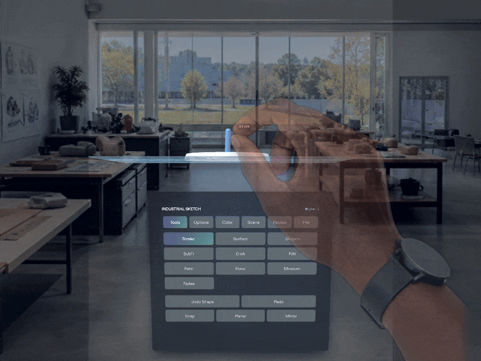

# Industrial Sketch

<!-- tags -->
    
<!-- /tags -->

## Overview

Industrial Sketch is a hand-tracked 3D sketching and concept-modeling tool for SPECS, built for industrial and product designers. Draw strokes, ribbons and surfaces in mid-air, block out forms with primitives and subdivision surfaces, reshape them with soft-falloff point editing, check proportions against a life-size mannequin and a tape measure, and review the result with collaborators in a shared session.

The whole app is created at runtime by one component (`IndustrialSketch`): geometry is generated with `MeshBuilder`, the tool palette is built from UI Kit components, input comes from Interaction Kit hand tracking, and collaboration uses Sync Kit.

> **NOTE:**
> This project will only work for the SPECS platform.

## Features

**Sketching**
- **Stroke** – freehand 3D strokes with round, square, triangle, ribbon or thin-line cross-sections, adjustable size, smoothing (One Euro filtering plus curve smoothing) and tapered ends. Ribbons twist with your hand.
- **Surface** – *Sweep* a surface with your hand (its width follows your knuckles), *Revolve* a profile around an axis, *Loft* between two curves, or *Fill* a closed loop with a patch.
- **Shapes** – cube, sphere, cylinder, cone, torus, plane, capsule and pyramid, dragged out from their center with a live preview and dimensions.
- **SubD** – subdivision-surface box, cylinder, sphere and plane cages (Catmull-Clark), sculpted by dragging cage vertices and faces, with face **extrusion**.

**Editing**
- **Grab** – pinch to move and rotate, add the other hand to scale. Tap to multi-select, then Duplicate, Mirror copy, Delete, Group / Ungroup, Straighten, Center on axis, Move to layer or Apply color.
- **Edit** – drag control points of any curve-based item; neighbours follow with an adjustable soft falloff. Shapes get per-axis stretch handles.
- **Paint** – sweep through objects to apply the current color and finish, or pick both with the eyedropper.
- **Erase** – sweep through objects to delete them.
- **Undo / Redo** – every operation, including clears and loads, is undoable (64 steps).

**Precision**
- **Symmetry** – live mirror across the sketch's center plane, or radial symmetry with 2–16 copies, with ghost cursors on the mirrored side.
- **Snap** – grid snapping (1, 2, 5 or 10 cm) for points, placements and moves, 15° angle snapping for rotations, and straight lines for strokes.
- **Planar** – draw on the plane of your other palm, which removes depth wobble from flat curves.
- **Measure** – dimension lines labelled in mm, cm or m at design scale.
- **Reference models** – a real-size chair, table, phone, mug, bottle and compact car to check proportions against, inserted as editable groups.

**Workspace**
- **World navigation** – pinch with your non-dominant hand to move and turn the whole sketch, pinch with both hands to scale it (2%–2500%). *Reset view*, *Frame all* and *Life size 1:1* are one tap away.
- **Construction grid**, a 175 cm **mannequin** for scale, four **layers** with visibility, and a **Present** mode that hides the tools and turns the sketch on a turntable.
- **Materials** – a 12-color palette, HSV fine-tuning and six finishes (Matte, Satin, Gloss, Metal, Chrome, Flat), with live material previews on the swatches.
- **Left-handed mode**, and an optional palette that docks next to your non-dominant hand when you turn that palm toward you.

**Review**
- **Notes** – pin review comments anywhere in the sketch: one-tap presets (Fix, Approved, Thicker…) or your own text typed on the SPECS system keyboard. Pinch a note to change its text; Grab and Erase work on notes too.
- **Viewpoints** – save three views of the sketch and jump back to them; in a shared session, *Bring everyone to my view* moves every collaborator to your viewpoint.
- **Present** – a turntable mode for design reviews (Scene page).

**Files and collaboration**
- **Save / Open** to four slots on the device, plus an **autosave** that is restored the next time you open the Lens. Saved viewpoints are stored with the sketch.
- **Export** as **OBJ** (with MTL materials), **glTF 2.0** (PBR materials, meters) or **STL** (millimeters, for 3D printing), streamed to the Lens Studio Logger. Notes and dimension lines are not exported.
- **Co-creation** – choose *Multiplayer* on the start menu to sketch together: changes are shared live (including notes), late joiners receive the current sketch, and everyone's cursor is visible.

## Design Guidelines

Designing Lenses for SPECS offers all-new possibilities to rethink user interaction with digital spaces and the physical world.
Get started using our [Design Guidelines](https://developers.snap.com/spectacles/best-practices/design-for-spectacles/introduction-to-spatial-design)

## Prerequisites

- **Lens Studio**: v5.25+

**Note:** Ensure Lens Studio is [compatible with SPECS](https://developers.specs.com) for your SPECS device and OS versions.

- **SPECS OS Version**: v7.0+
- **SPECS App iOS**: v1.7+
- **SPECS App Android**: v1.7+

To update your SPECS device and mobile app, please refer to this [guide](https://developers.specs.com).

You can download the latest version of Lens Studio from [here](https://lensstudio.com).

## Getting Started

To obtain the project folder, clone the repository.

> **IMPORTANT:**
> This project uses Git Large Files Support (LFS). Downloading a zip file using the green button on GitHub **will not work**. You must clone the project with a version of git that has LFS.
> You can download Git LFS [here](https://git-lfs.github.com/).

## Initial Project Setup

The project should be pre-configured to get you started without any additional steps. However, if you encounter issues in the Logger Panel, please ensure your Lens Studio environment is set up for [SPECS](https://developers.snap.com/spectacles/get-started/start-buiding/preview-panel).

The scene contains the standard SPECS setup (camera, lighting, Interaction Kit), the Sync Kit start menu, and one `Industrial Sketch` object. Its component only needs a lit material (`Materials/Sketch PBR`) and an unlit material (`Materials/Sketch Unlit`); everything else is created by script.

## How to use it

| Hand | Action |
|---|---|
| Dominant hand (right by default) | Pinch to use the active tool: draw, place, grab, edit, paint, erase or measure. |
| Non-dominant hand | Pinch in empty space to move and turn the sketch. |
| Both hands | Pinch with both hands to scale the sketch around the point between them. While grabbing an object, pinch with the other hand to scale the object instead. |
| Palette | Pinch (or poke) the buttons. Drag the palette by its border to move it. |

The palette has seven pages (it opens on **Learn**):
- **Tools** – the ten tools, Undo / Redo, and quick toggles for Snap, Planar and Mirror.
- **Options** – settings for the active tool (cross-section, surface mode, shape, SubD cage, size, smoothing, falloff, extrude, selection actions, note text).
- **Color** – palette swatches, finishes and HSV sliders.
- **Scene** – symmetry, grid, mannequin, presentation, view reset / framing / 1:1, layers, left-handed mode and palette-on-hand.
- **Review** – save and go to viewpoints, bring collaborators to your view, and insert reference models.
- **File** – save and open slots, New sketch (undoable), export (OBJ, glTF, STL) and the collaboration status.
- **Learn** – a short explanation of every part of the lens (start, drawing, editing, precision, color, scene, review, files and sharing), one topic per button.

## Key Scripts

[IndustrialSketch.ts](./Assets/Scripts/IndustrialSketch.ts) – Entry component: builds the app, routes the hands between world navigation and tools, autosaves, and implements the palette actions.

[Core/SketchDocument.ts](./Assets/Scripts/Core/SketchDocument.ts) – The sketch as plain, serializable items, with snapshot-based undo / redo and live (unrecorded) edits for dragging.

[Core/ItemGeometry.ts](./Assets/Scripts/Core/ItemGeometry.ts) – Turns an item into its mesh (with baked symmetry) and answers picking queries.

[Geometry/](./Assets/Scripts/Geometry/) – Engine-independent geometry kernel: swept tubes and ribbons (`TubeBuilder`), revolve / loft / sweep / fill surfaces (`SurfaceBuilder`), primitives, Catmull-Clark subdivision with extrusion (`SubD`), symmetry and curve filtering / editing (`Curve`).

[Input/HandTracker.ts](./Assets/Scripts/Input/HandTracker.ts) – Per-hand pinch point, orientation, palm direction and UI blocking from Interaction Kit; drives the dominant hand with the mouse in the Lens Studio Preview.

[Tools/](./Assets/Scripts/Tools/) – One class per tool (`StrokeTool`, `SurfaceTool`, `PlaceTool`, `GrabTool`, `EditTool`, `BrushTools`, `NoteTool`) plus `SelectionActions`.

[Workspace/Workspace.ts](./Assets/Scripts/Workspace/Workspace.ts) – The sketch root, one- and two-hand world navigation, viewpoints, grid, mannequin and presentation turntable. [Workspace/ReferenceLibrary.ts](./Assets/Scripts/Workspace/ReferenceLibrary.ts) – The real-size reference models.

[UI/Palette.ts](./Assets/Scripts/UI/Palette.ts) – The UI Kit tool palette, built at runtime, including the Learn page.

[Persistence/SketchStorage.ts](./Assets/Scripts/Persistence/SketchStorage.ts) – Save slots and autosave in persistent storage; [Persistence/ObjExporter.ts](./Assets/Scripts/Persistence/ObjExporter.ts) and [Persistence/GltfStlExporter.ts](./Assets/Scripts/Persistence/GltfStlExporter.ts) – OBJ / MTL, glTF and STL export.

[Collab/CollabSession.ts](./Assets/Scripts/Collab/CollabSession.ts) – Sync Kit co-creation: throttled item updates, late-join snapshots, remote cursors and shared viewpoints.

## Testing the Lens

### In Lens Studio Editor

1. Open `IndustrialSketch.esproj` and select the **SPECS** device in the **Preview** panel.
2. Choose **Solo** on the start menu.
3. The mouse acts as your drawing hand: click and drag in the Preview to draw. The palette floats to the left of the view; look left (or move the Preview camera) to reach it and click its buttons.
4. Keyboard shortcuts work in the Preview: `1`–`9` select tools, `D` notes, `S` save view 1, `Z` / `Y` undo / redo, `M` mirror, `R` radial, `O` symmetry off, `N` snap, `P` planar, `G` grid, `K` mannequin, `C` cross-section, `X` surface mode, `B` shape, `V` SubD cage, `L` finish, `H` color, `E` extrude, `U` duplicate, `Backspace` delete, `W` new sketch, `A` select all, `I` eyedropper, `F` frame all, `Space` reset view, `T` present, `Up` / `Down` brush size, `0` save to slot 1, `J` open slot 1 and `Q` export OBJ.
5. To try collaboration, open a second Preview panel and choose **Multiplayer** in both: what you draw in one appears in the other.

Turn on **Debug Logging** on the `IndustrialSketch` component to log hand routing, item changes and history in the Logger.

### On SPECS Device

1. Build and push the Lens to your SPECS device from Lens Studio.
2. Choose **Solo**, or **Multiplayer** to sketch with others ([Connected Lenses guide](https://developers.snap.com/spectacles/about-spectacles-features/connected-lenses/building-connected-lenses)).
3. Pinch with your dominant hand to draw. Pinch with the other hand to move the sketch, and with both hands to scale it.
4. Pinch the palette buttons to change tools and settings. Turn on **Palette on hand** (Scene page) to summon it by turning your palm toward you.
5. Use **File › Export OBJ / glTF / STL** with the device connected to Lens Studio, then copy the text between each `BEGIN` / `END` marker pair in the Logger into a file of that name. For glTF, decode the buffer next to the `.gltf` file: `base64 -D -i industrial_sketch.bin.b64 -o industrial_sketch.bin` (macOS) or `base64 -d industrial_sketch.bin.b64 > industrial_sketch.bin` (Linux).
6. On the **Notes** tool, **Type a note…** opens the SPECS system keyboard (the Lens Studio Preview has no keyboard; use the presets there).

## Limitations

- Sketches are saved on the device only; there is no cloud library or cross-device sharing. Export goes through the Logger because Lenses cannot write files.
- Surfaces are polygon meshes: there is no NURBS geometry and no FBX or IGES export (use glTF or OBJ and convert in a CAD tool).
- Images and 3D files can't be imported into a Lens at runtime; use the built-in reference models for scale.
- Collaborators share the sketch, not a physical space: everyone sees it in front of them at their own view scale.
- Undo is per person and restores whole items: undoing your move of an object a collaborator has since recolored also restores the old color for everyone.
- Subdivision surfaces are smoothed at level 2 to stay responsive on device; very dense sketches (thousands of strokes) will slow down editing.

## Support

If you have any questions or need assistance, please don't hesitate to reach out. Our community is here to help, and you can connect with us and ask for support [here](https://www.reddit.com/r/Spectacles/). We look forward to hearing from you and are excited to assist you on your journey!

## Contributing

Feel free to provide improvements or suggestions or directly contributing via merge request. By sharing insights, you help everyone else build better Lenses.

---

*Built with 👽 by the SPECS team*
