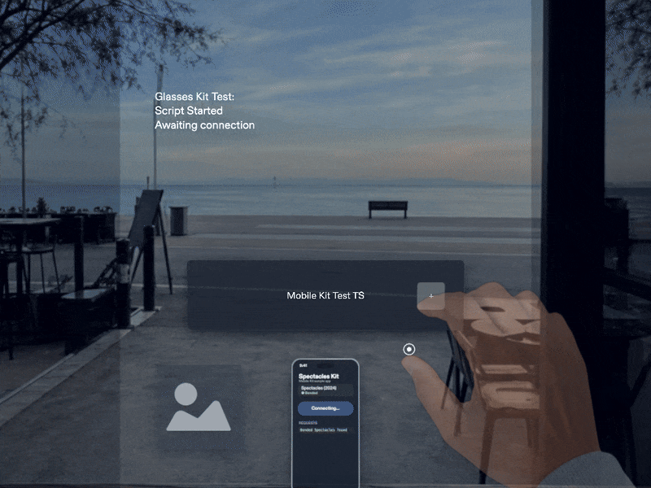

# Mobile Kit

<!-- tags -->
    
<!-- /tags -->

## Overview

Mobile Kit is a SDK that enables seamless communication between mobile applications and Lenses running on SPECS via Bluetooth Low Energy (BLE). This sample demonstrates how to establish a secure session, send one-way data, perform request-response exchanges, subscribe to topics, and load remote textures and meshes from a companion mobile app. Learn more about the SPECS Mobile Kit in the [official documentation](https://developers.snap.com/spectacles/spectacles-frameworks/spectacles-mobile-kit/getting-started).

## Design Guidelines

Designing Lenses for SPECS offers all-new possibilities to rethink user interaction with digital spaces and the physical world.
Get started using our [Design Guidelines](https://developers.snap.com/spectacles/best-practices/design-for-spectacles/introduction-to-spatial-design)

## Prerequisites

- **Lens Studio**: v5.25+

**Note:** Ensure Lens Studio is [compatible with SPECS](https://developers.specs.com) for your SPECS device and OS versions.

- **SPECS OS Version**: v7.0+
- **SPECS App iOS**: v1.0+
- **SPECS App Android**: v1.0+

To update your SPECS device and mobile app, please refer to this [guide](https://developers.specs.com).

You can download the latest version of Lens Studio from [here](https://lensstudio.com).

## Getting Started

To obtain the project folder, clone the repository.

> **IMPORTANT:**
> This project uses Git Large Files Support (LFS). Downloading a zip file using the green button on GitHub **will not work**. You must clone the project with a version of git that has LFS.
> You can download Git LFS [here](https://git-lfs.github.com/).

## Initial Project Setup

The project should be pre-configured to get you started without any additional steps. However, if you encounter issues in the Logger Panel, please ensure your Lens Studio environment is set up for [SPECS](https://developers.snap.com/spectacles/get-started/start-buiding/preview-panel).

Before running the sample, you will also need a companion mobile app for bonding and session management:

- **iOS**: Open [app/iOS/SpectaclesKitSample/](app/iOS/SpectaclesKitSample/) in Xcode 16 and run on a physical iPhone.
- **Android**: Import [app/Android/SpectaclesKitSample/](app/Android/SpectaclesKitSample/) in Android Studio and run on a physical device.

The bonding flow must be completed once via the SPECS App before a session can be established.

## Key Script

[MobileKitTest_TS.ts](./Assets/Scripts/MobileKitTest_TS.ts) - Drives the full Mobile Kit demo: creates a BLE session with the companion app, performs one-way data send, request-response exchanges, topic subscriptions, and remote texture/mesh loading via the Internet and RemoteMedia modules.

## Testing the Lens

### In Lens Studio Editor

1. Open [MobileKit.esproj](MobileKit.esproj) in Lens Studio.
2. Go to **Project Settings** and verify the Lens Name is set to `SpecsMobileKit` (the sample apps look for this name and the Lens ID `com.snap.mobilekittest`).
3. Open the **Preview Panel** and select the SPECS preview mode.
4. Review the Logger Panel for connection status and any errors.

> **NOTE**: This project will only work for the SPECS platform.

### In SPECS Device

1. Click **Preview Lens** in Lens Studio to install and launch the Lens on your SPECS.
2. Launch the companion mobile app on your phone:
   - **iOS**: Tap **SpectaclesKit bind**, grant Bluetooth access, approve the bond in the SPECS App, then tap **Start Session**.
   - **Android**: Tap the **+** button, approve permissions and the bond in the SPECS App — the app connects automatically.
3. Once connected, the Lens displays the session status, loads a remote image and mesh, and shows subscription responses from the mobile app.
4. If `Reset After Delay` is enabled, the session closes automatically after 10 seconds.

## Support

If you have any questions or need assistance, please don't hesitate to reach out. Our community is here to help, and you can connect with us and ask for support [here](https://www.reddit.com/r/Spectacles/). We look forward to hearing from you and are excited to assist you on your journey!

## Contributing

Feel free to provide improvements or suggestions or directly contributing via merge request. By sharing insights, you help everyone else build better Lenses.

---

 

​

​

​

​

​

---

*Built with 👽 by the SPECS team*
