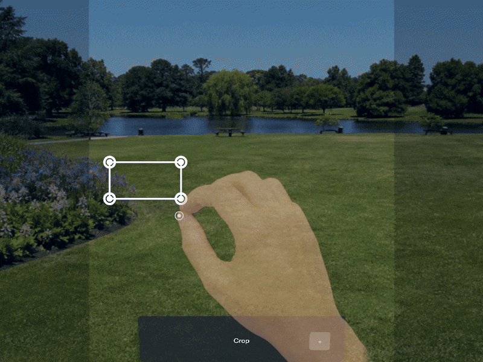
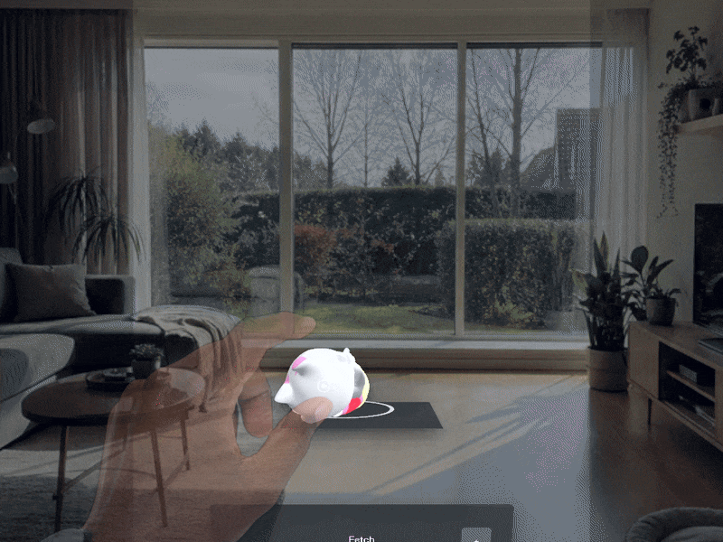
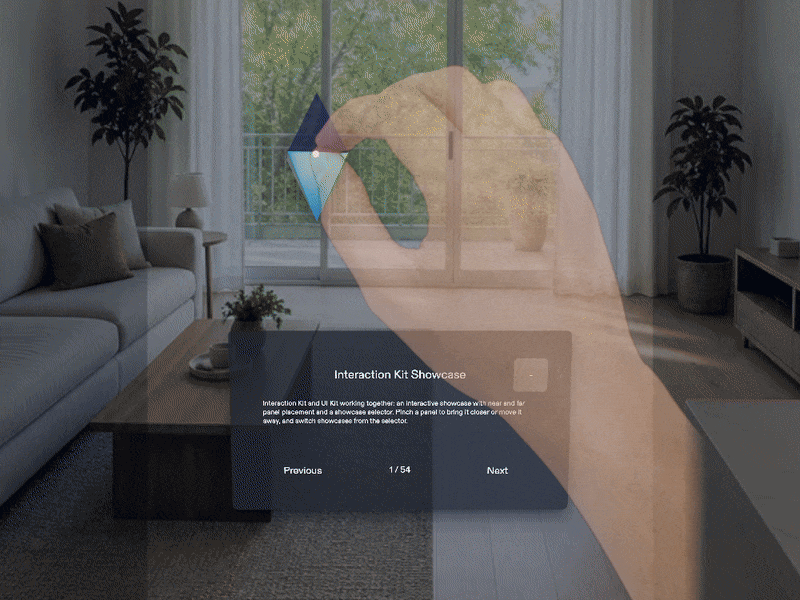
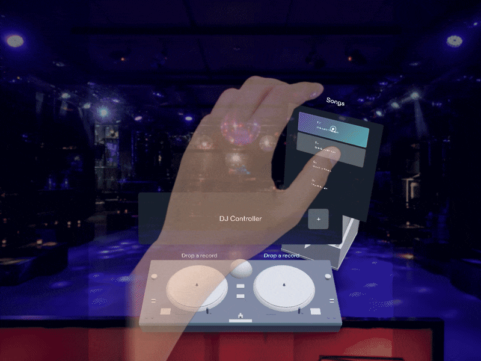

<div align="center">


# SPECS Samples

**Ready-to-use Lens Studio projects for building on SPECS.**

[](https://github.com/specs-devs/samples/releases/tag/5.24.0)
[](https://ar.snap.com/lens-studio)
[](https://developers.specs.com/)
[](https://www.reddit.com/r/Spectacles/)
[](https://www.youtube.com/@specsfordevs)

---

</div>

Each folder is a complete, working Lens Studio project you can open, run and use as a starting point.

## Releases

| Branch | Lens Studio | Device | Release |
|:--|:--|:--|:--|
| [`main`](https://github.com/specs-devs/samples/tree/main) | 5.25.0 | SPECS 27 | [5.25.0](https://github.com/specs-devs/samples/releases/tag/5.25.0) |
| [`5.24.1`](https://github.com/specs-devs/samples/tree/5.24.1) | 5.24.1 | SPECS 27 | [5.24.1](https://github.com/specs-devs/samples/releases/tag/5.24.1) |
| [`5.24`](https://github.com/specs-devs/samples/tree/5.24) | 5.24.0 | SPECS 27 | [5.24.0](https://github.com/specs-devs/samples/releases/tag/5.24.0) ← you are here |
| [`5.22`](https://github.com/specs-devs/samples/tree/5.22) | 5.22.0 | SPECS 27 | [5.22.0](https://github.com/specs-devs/samples/releases/tag/5.22.0) |
| [`5.15.4`](https://github.com/specs-devs/samples/tree/5.15.4) | 5.15.4 | Spectacles (2024) | [5.15.4](https://github.com/specs-devs/samples/releases/tag/5.15.4) |

> [!IMPORTANT]
> Use the branch that matches your Lens Studio version. `main` always carries the latest release.
> **Spectacles (2024) is supported only on `5.15.4`.** Everything `5.22.0`+ targets SPECS 27.

## Getting Started

This repository uses **Git LFS** for large assets. Install it once before cloning:

```bash
git lfs install
```

Clone everything:

```bash
git clone --branch 5.24 https://github.com/specs-devs/samples.git
```

Or clone a single project with sparse checkout:

```bash
git clone --branch 5.24 --filter=blob:none --sparse https://github.com/specs-devs/samples.git
cd samples && git sparse-checkout add "Essentials"
```

Then open the project folder in Lens Studio.

## Project index

| | | |
|:--|:--|:--|
| [AI Playground](./AI%20Playground/) | [Crop](./Crop/) | [Depth Cache](./Depth%20Cache/) |
| [AI Music Gen](./AI%20Music%20Gen/) | [Agent Manager](./Agent%20Manager/) | [Fetch](./Fetch/) |
| [Essentials](./Essentials/) | [Spatial Image](./Spatial%20Image/) | [Throw Lab](./Throw%20Lab/) |
| [Voice Playback](./Voice%20Playback/) | [Path Pioneer](./Path%20Pioneer/) | [Mobile Kit](./Mobile%20Kit/) |
| [DJ](./DJ/) | [Custom Locations](./Custom%20Locations/) | [Navigation Kit](./Navigation%20Kit/) |
| [Sync Kit](./Sync%20Kit%20Basic%20Example/) | [Base Template](./Base%20Template/) | [Base Template With Examples](./Base%20Template%20With%20Examples/) |

## AI

AI-powered experiences and integrations

<table>
  <tr>
    <td align="center" valign="top" width="33%">
      <a href="./AI Playground/">
        
      </a>
      <h3>AI Playground</h3>
      <!-- tags:AI Playground -->
      <p>
        <a href="https://developers.snap.com/spectacles/about-spectacles-features/overview"></a>
        <a href="https://developers.snap.com/spectacles/about-spectacles-features/compatibility-list"></a>
        <a href="https://developers.snap.com/spectacles/about-spectacles-features/compatibility-list"></a>
        <a href="https://developers.snap.com/spectacles/about-spectacles-features/compatibility-list"></a>
        <a href="https://developers.snap.com/spectacles/about-spectacles-features/compatibility-list"></a>
      </p>
      <!-- /tags:AI Playground -->
      <p>Sample project for AI in using SPECS Remote Service Gateway.</p>
    </td>
    <td align="center" valign="top" width="33%">
      <a href="./Crop/">
        
      </a>
      <h3>Crop</h3>
      <!-- tags:Crop -->
      <p>
        <a href="https://developers.snap.com/spectacles/about-spectacles-features/overview"></a>
        <a href="https://developers.snap.com/spectacles/about-spectacles-features/compatibility-list"></a>
        <a href="https://developers.snap.com/spectacles/about-spectacles-features/apis/gesture-module"></a>
        <a href="https://developers.snap.com/spectacles/about-spectacles-features/apis/camera-module"></a>
        <a href="https://developers.snap.com/spectacles/about-spectacles-features/compatibility-list"></a>
      </p>
      <!-- /tags:Crop -->
      <p>Sample project showing how to "crop" the environment using hand gesture.</p>
    </td>
    <td align="center" valign="top" width="33%">
      <a href="./Depth Cache/">
        
      </a>
      <h3>Depth Cache</h3>
      <!-- tags:Depth Cache -->
      <p>
        <a href="https://developers.snap.com/spectacles/about-spectacles-features/overview"></a>
        <a href="https://developers.snap.com/spectacles/about-spectacles-features/compatibility-list"></a>
        <a href="https://developers.snap.com/lens-studio/features/ar-tracking/world/world-mesh-and-depth-texture"></a>
        <a href="https://developers.snap.com/lens-studio/features/ar-tracking/world/world-mesh-and-depth-texture"></a>
        <a href="https://developers.snap.com/lens-studio/features/ar-tracking/world/world-mesh-and-depth-texture"></a>
      </p>
      <!-- /tags:Depth Cache -->
      <p>Cache depth frames for pixel-to-3D projection with cloud-based vision models.</p>
    </td>
  </tr>
  <tr>
    <td align="center" valign="top" width="33%">
      <a href="./AI Music Gen/">
        
      </a>
      <h3>AI Music Gen</h3>
      <!-- tags:AI Music Gen -->
      <p>
        <a href="https://developers.snap.com/spectacles/about-spectacles-features/overview"></a>
        <a href="https://developers.snap.com/lens-studio/features/audio/playing-audio"></a>
        <a href="https://developers.snap.com/spectacles/about-spectacles-features/compatibility-list"></a>
        <a href="https://developers.snap.com/spectacles/about-spectacles-features/apis/snap3d"></a>
        <a href="https://developers.snap.com/spectacles/about-spectacles-features/compatibility-list"></a>
      </p>
      <!-- /tags:AI Music Gen -->
      <p>Generate AI music using Google's Lyria model. Combine genres, vibes, and instruments to create custom music tracks with 3D visualizations.</p>
    </td>
    <td align="center" valign="top" width="33%">
      <a href="./Agent Manager/">
        
      </a>
      <h3>Agent Manager</h3>
      <!-- tags:Agent Manager -->
      <p>
        <a href="https://developers.snap.com/spectacles/spectacles-frameworks/spectacles-interaction-kit/features/overview"></a>
        <a href="https://developers.snap.com/spectacles/about-spectacles-features/overview"></a>
        <a href="https://developers.snap.com/spectacles/about-spectacles-features/compatibility-list"></a>
        <a href="https://developers.snap.com/spectacles/about-spectacles-features/compatibility-list"></a>
        <a href="https://developers.snap.com/spectacles/about-spectacles-features/compatibility-list"></a>
      </p>
      <!-- /tags:Agent Manager -->
      <p>Multi-agent assistant hub for SPECS—run and manage multiple AI agents with text and voice input.</p>
    </td>
    <td width="33%"></td>
  </tr>
</table>

## Getting Started

Essential projects to get you started with SPECS development

<table>
  <tr>
    <td align="center" valign="top" width="33%">
      <a href="./Fetch/">
        
      </a>
      <h3>Fetch</h3>
      <!-- tags:Fetch -->
      <p>
        <a href="https://developers.snap.com/spectacles/spectacles-frameworks/spectacles-interaction-kit/features/overview"></a>
        <a href="https://developers.snap.com/spectacles/about-spectacles-features/apis/fetch"></a>
        <a href="https://developers.snap.com/lens-studio/features/scripting/scripting-overview"></a>
        <a href="https://developers.snap.com/spectacles/about-spectacles-features/apis/experimental-apis"></a>
        <a href="https://developers.snap.com/spectacles/about-spectacles-features/apis/web-view"></a>
      </p>
      <!-- /tags:Fetch -->
      <p>Sample project using the SPECS Fetch API.</p>
    </td>
    <td align="center" valign="top" width="33%">
      <a href="./Essentials/">
        
      </a>
      <h3>Essentials</h3>
      <!-- tags:Essentials -->
      <p>
        <a href="https://developers.snap.com/spectacles/spectacles-frameworks/spectacles-interaction-kit/features/overview"></a>
        <a href="https://developers.snap.com/spectacles/about-spectacles-features/apis/gesture-module"></a>
        <a href="https://developers.snap.com/lens-studio/api/lens-scripting/classes/Built-In.AnimationPlayer.html"></a>
        <a href="https://developers.snap.com/lens-studio/features/physics/physics-overview"></a>
        <a href="https://developers.snap.com/lens-studio/api/lens-scripting/classes/Built-In.RayCastHit.html"></a>
      </p>
      <!-- /tags:Essentials -->
      <p>Collection of foundational concepts for creating lenses in Lens Studio.</p>
    </td>
    <td align="center" valign="top" width="33%">
      <a href="./Spatial Image/">
        
      </a>
      <h3>Spatial Image</h3>
      <!-- tags:Spatial Image -->
      <p>
        <a href="https://developers.snap.com/spectacles/spectacles-frameworks/spectacles-interaction-kit/features/overview"></a>
        <a href="https://developers.snap.com/lens-studio/features/graphics/materials/overview"></a>
        <a href="https://developers.snap.com/lens-studio/features/graphics/rendering-overview"></a>
        <a href="https://developers.snap.com/lens-studio/features/ar-tracking/world/world-mesh-and-depth-texture"></a>
        <a href="https://developers.snap.com/spectacles/about-spectacles-features/apis/spatial-image"></a>
      </p>
      <!-- /tags:Spatial Image -->
      <p>Convert your 2D images to 3D.</p>
    </td>
  </tr>
  <tr>
    <td align="center" valign="top" width="33%">
      <a href="./Throw Lab/">
        
      </a>
      <h3>Throw Lab</h3>
      <!-- tags:Throw Lab -->
      <p>
        <a href="https://developers.snap.com/spectacles/spectacles-frameworks/spectacles-interaction-kit/features/overview"></a>
        <a href="https://developers.snap.com/spectacles/about-spectacles-features/apis/gesture-module"></a>
        <a href="https://developers.snap.com/lens-studio/api/lens-scripting/classes/Built-In.AnimationPlayer.html"></a>
        <a href="https://developers.snap.com/lens-studio/features/physics/physics-overview"></a>
        <a href="https://developers.snap.com/lens-studio/api/lens-scripting/classes/Built-In.RayCastHit.html"></a>
      </p>
      <!-- /tags:Throw Lab -->
      <p>Sample project demonstrating realistic throwing mechanics in AR.</p>
    </td>
    <td align="center" valign="top" width="33%">
      <a href="./Voice Playback/">
        
      </a>
      <h3>Voice Playback</h3>
      <!-- tags:Voice Playback -->
      <p>
        <a href="https://developers.snap.com/spectacles/spectacles-frameworks/spectacles-interaction-kit/features/overview"></a>
        <a href="https://developers.snap.com/spectacles/spectacles-frameworks/spectacles-interaction-kit/features/overview"></a>
        <a href="https://developers.snap.com/lens-studio/features/audio/playing-audio"></a>
        <a href="https://developers.snap.com/spectacles/about-spectacles-features/apis/asr-module"></a>
        <a href="https://developers.snap.com/lens-studio/features/scripting/scripting-overview"></a>
      </p>
      <!-- /tags:Voice Playback -->
      <p>Sample project for recording and playing back audio on SPECS.</p>
    </td>
    <td align="center" valign="top" width="33%">
      <a href="./Path Pioneer/">
        
      </a>
      <h3>Path Pioneer</h3>
      <!-- tags:Path Pioneer -->
      <p>
        <a href="https://developers.snap.com/spectacles/spectacles-frameworks/spectacles-interaction-kit/features/overview"></a>
        <a href="https://developers.snap.com/lens-studio/features/ar-tracking/world/surface-detection"></a>
        <a href="https://developers.snap.com/lens-studio/features/graphics/materials/overview"></a>
        <a href="https://developers.snap.com/lens-studio/api/lens-scripting/classes/Built-In.AnimationPlayer.html"></a>
        <a href="https://developers.snap.com/lens-studio/api/lens-scripting/classes/Built-In.RayCastHit.html"></a>
      </p>
      <!-- /tags:Path Pioneer -->
      <p>Sample project for path creation and path walking experience.</p>
    </td>
  </tr>
  <tr>
    <td align="center" valign="top" width="33%">
      <a href="./Mobile Kit/">
        
      </a>
      <h3>Mobile Kit</h3>
      <!-- tags:Mobile Kit -->
      <p>
        <a href="https://developers.snap.com/spectacles/spectacles-frameworks/spectacles-interaction-kit/features/overview"></a>
        <a href="https://developers.snap.com/spectacles/spectacles-frameworks/spectacles-interaction-kit/features/overview"></a>
        <a href="https://developers.snap.com/lens-studio/features/scripting/scripting-overview"></a>
        <a href="https://developers.snap.com/spectacles/spectacles-frameworks/spectacles-mobile-kit/getting-started"></a>
        <a href="https://developers.snap.com/spectacles/about-spectacles-features/connected-lenses/overview"></a>
      </p>
      <!-- /tags:Mobile Kit -->
      <p>SDK for seamless communication between mobile applications and Lenses running on SPECS via BLE.</p>
    </td>
    <td align="center" valign="top" width="33%">
      <a href="./DJ/">
        
      </a>
      <h3>DJ</h3>
      <!-- tags:DJ -->
      <p>
        <a href="https://developers.snap.com/spectacles/spectacles-frameworks/spectacles-interaction-kit/features/overview"></a>
        <a href="https://developers.snap.com/spectacles/about-spectacles-features/apis/gesture-module"></a>
        <a href="https://developers.snap.com/lens-studio/features/audio/playing-audio"></a>
        <a href="https://developers.snap.com/lens-studio/api/lens-scripting/classes/Built-In.AnimationPlayer.html"></a>
        <a href="https://developers.snap.com/lens-studio/features/physics/physics-overview"></a>
      </p>
      <!-- /tags:DJ -->
      <p>Interactive DJ turntable experience with realistic vinyl physics and multi-track audio mixing.</p>
    </td>
    <td width="33%"></td>
  </tr>
</table>

## Navigation

Location-based and navigation experiences

<table>
  <tr>
    <td align="center" valign="top" width="33%">
      <a href="./Custom Locations/">
        
      </a>
      <h3>Custom Locations</h3>
      <!-- tags:Custom Locations -->
      <p>
        <a href="https://developers.snap.com/spectacles/spectacles-frameworks/spectacles-interaction-kit/features/overview"></a>
        <a href="https://developers.snap.com/spectacles/about-spectacles-features/apis/location"></a>
        <a href="https://developers.snap.com/spectacles/about-spectacles-features/apis/custom-locations"></a>
        <a href="https://developers.snap.com/lens-studio/features/location-ar/map-component"></a>
        <a href="https://developers.snap.com/lens-studio/features/remote-apis/snap-places-api"></a>
      </p>
      <!-- /tags:Custom Locations -->
      <p>Map real life areas and create AR experiences around those locations.</p>
    </td>
    <td align="center" valign="top" width="33%">
      <a href="./Navigation Kit/">
        
      </a>
      <h3>Navigation Kit</h3>
      <!-- tags:Navigation Kit -->
      <p>
        <a href="https://developers.snap.com/spectacles/spectacles-frameworks/spectacles-interaction-kit/features/overview"></a>
        <a href="https://developers.snap.com/spectacles/about-spectacles-features/apis/custom-locations"></a>
        <a href="https://developers.snap.com/spectacles/about-spectacles-features/compatibility-list"></a>
        <a href="https://developers.snap.com/lens-studio/features/location-ar/map-component"></a>
        <a href="https://developers.snap.com/lens-studio/features/remote-apis/snap-places-api"></a>
      </p>
      <!-- /tags:Navigation Kit -->
      <p>An example project for indoors or outdoors navigation.</p>
    </td>
    <td width="33%"></td>
  </tr>
</table>

## Connected Lenses

Multi-user collaborative experiences

<table>
  <tr>
    <td align="center" valign="top" width="33%">
      <a href="./Sync Kit Basic Example/">
        
      </a>
      <h3>Sync Kit</h3>
      <!-- tags:Sync Kit Basic Example -->
      <p>
        <a href="https://developers.snap.com/spectacles/spectacles-frameworks/spectacles-interaction-kit/features/overview"></a>
        <a href="https://developers.snap.com/spectacles/spectacles-frameworks/spectacles-sync-kit"></a>
        <a href="https://developers.snap.com/spectacles/about-spectacles-features/connected-lenses/overview"></a>
        <a href="https://developers.snap.com/spectacles/about-spectacles-features/connected-lenses/overview"></a>
        <a href="https://developers.snap.com/lens-studio/features/lens-cloud/lens-cloud-overview"></a>
      </p>
      <!-- /tags:Sync Kit Basic Example -->
      <p>Minimal example of Sync Kit transform synchronization across Connected Lenses.</p>
    </td>
    <td width="33%"></td>
    <td width="33%"></td>
  </tr>
</table>

## Snap Cloud

Cloud-powered experiences using Snap Cloud (powered by Supabase)

<table>
  <tr>
    <td width="33%"></td>
    <td width="33%"></td>
    <td width="33%"></td>
  </tr>
</table>

## Templates

Blank starting points for building new projects from scratch.

| Template | Path | Description |
| :--- | :--- | :--- |
| Base Template | `Base Template/` | Minimal empty project — start here for a clean slate. |
| Base Template With Examples | `Base Template With Examples/` | Base template pre-populated with example content to build on. |

## Additional Resources

- **[SPECS Developer Documentation](https://developers.specs.com/)** - Guides and API references
- **[Lens Studio](https://ar.snap.com/lens-studio)** - Download Lens Studio
- **[Community](https://www.reddit.com/r/Spectacles/)** - Connect with other developers and get support
- **[SPECS on GitHub](https://github.com/specs-devs)** - Samples, packages, core frameworks and icons

---

*Built with 👽 by the SPECS team*
