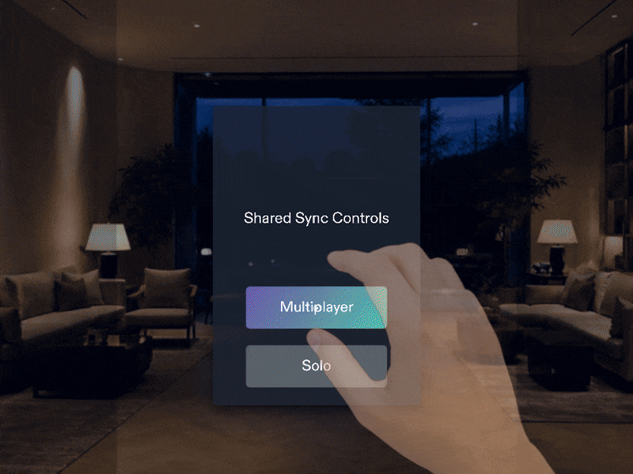

# Shared Sync Controls

    

## Overview

This project showcases a real-time collaborative AR experience on Connected Lenses: **UIKit** RGB sliders, a shared **TextInputField**, and a **RectangleButton** stay in sync for every user via a single `GeneralDataStore`. RGB values still drive the color of the scene object. All interactions are mirrored across devices.
This lens leverages the [Interaction Kit (SIK)](https://developers.snap.com/spectacles/spectacles-frameworks/spectacles-interaction-kit/get-started) to simplify UI development for SPECS and demonstrates the potential of [Connected Lenses](https://developers.snap.com/spectacles/about-spectacles-features/connected-lenses/overview) for creating engaging, synchronized AR experiences.

> **NOTE**: This project will only work for the SPECS platform.

## Design Guidelines

Designing Lenses for SPECS offers all-new possibilities to rethink user interaction with digital spaces and the physical world.
Get started using our [Design Guidelines](https://developers.snap.com/spectacles/best-practices/design-for-spectacles/introduction-to-spatial-design)

## Prerequisites

- **Lens Studio**: v5.25+

**Note:** Ensure Lens Studio is [compatible with SPECS](https://developers.specs.com) for your SPECS device and OS versions.

- **SPECS OS Version**: v7.0+
- **SPECS App iOS**: v1.7+
- **SPECS App Android**: v1.7+

To update your SPECS device and mobile app, please refer to this [guide](https://developers.specs.com).

You can download the latest version of Lens Studio from [here](https://lensstudio.com).

## Getting Started

To obtain the project folder, clone the repository.

> **IMPORTANT:**
> This project uses Git Large Files Support (LFS). Downloading a zip file using the green button on GitHub **will not work**. You must clone the project with a version of git that has LFS.
> You can download Git LFS [here](https://git-lfs.github.com/).

## Initial Project Setup

The project should be pre-configured to get you started without any additional steps. However, if you encounter issues in the Logger Panel, please ensure your Lens Studio environment is set up for [SPECS](https://developers.snap.com/spectacles/get-started/start-buiding/preview-panel).

## Key Script

[UIKitSyncManager.ts](./Assets/Scripts/UIKitSyncManager.ts) - Single component that joins or creates a shared `GeneralDataStore`, binds **UIKit** `Slider`, `TextInputField`, and `RectangleButton` inputs to store keys, and applies synced RGB values to the target material so every user sees the same UI and object color in real time.

## Testing the Lens

### In Lens Studio Editor

1. Open the Lens in Lens Studio and create two Interactive Previews using the [Interactive Preview Panel](https://developers.snap.com/lens-studio/lens-studio-workflow/previewing-your-lens#interactive-preview).
2. Click the Multiplayer button for both previews. They will connect to the same session and map surroundings automatically.
3. Test functionality:
   - Adjust the RGB sliders in one preview and confirm the floating object's color updates in both previews in real time.
   - Edit the shared text field or tap the synced button in one preview and confirm the other preview updates to match.

### In SPECS Device

1. Connect two pairs of SPECS to the same session following the [Playing Connected Lenses Guide](https://developers.snap.com/spectacles/about-spectacles-features/connected-lenses/overview#playing-connected-lenses-on-spectacles).
2. Test functionality:
   - Use the RGB sliders on one device and ensure the floating object's color updates in real time on both devices.
   - Change the shared text field or button on one device and confirm the other device stays in sync.

## Support

If you have any questions or need assistance, please don't hesitate to reach out. Our community is here to help, and you can connect with us and ask for support [here](https://www.reddit.com/r/Spectacles/). We look forward to hearing from you and are excited to assist you on your journey!

## Contributing

Feel free to provide improvements or suggestions or directly contributing via merge request. By sharing insights, you help everyone else build better Lenses.

---

*Built with 👽 by the SPECS team*

---
 

​

​

​

​
