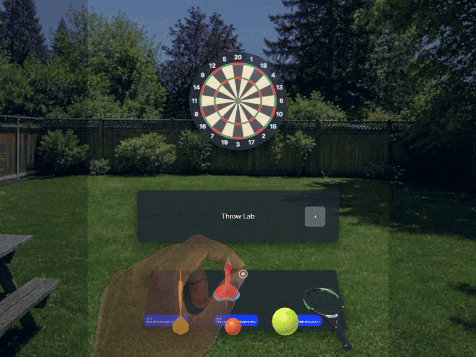

# Throw Lab

<!-- tags -->
    
<!-- /tags -->

## Overview

Throw Lab demonstrates how to implement realistic grabbing and throwing mechanics in Lens Studio using hand tracking and physics. It features a modular, componentized architecture supporting three distinct object types — Balls, Rackets, and Darts — each with unique grab gestures, rotation behaviors, and throw physics. By exploring this project, you will gain a practical understanding of how to combine the [Gesture Module](https://developers.snap.com/spectacles/about-spectacles-features/apis/gesture-module), [Physics](https://developers.snap.com/lens-studio/features/physics/physics-overview), and Interaction Kit to build engaging, hand-driven AR interactions.

> **NOTE:**
> This project will only work for the SPECS platform.

## Design Guidelines

Designing Lenses for SPECS offers all-new possibilities to rethink user interaction with digital spaces and the physical world.
Get started using our [Design Guidelines](https://developers.snap.com/spectacles/best-practices/design-for-spectacles/introduction-to-spatial-design)

## Prerequisites

- **Lens Studio**: v5.25+

**Note:** Ensure Lens Studio is [compatible with SPECS](https://developers.specs.com) for your SPECS device and OS versions.

- **SPECS OS Version**: v7.0+
- **SPECS App iOS**: v1.7+
- **SPECS App Android**: v1.7+

To update your SPECS device and mobile app, please refer to this [guide](https://developers.specs.com).

You can download the latest version of Lens Studio from [here](https://lensstudio.com).

## Getting Started

To obtain the project folder, clone the repository.

> **IMPORTANT:**
> This project uses Git Large Files Support (LFS). Downloading a zip file using the green button on GitHub **will not work**. You must clone the project with a version of git that has LFS.
> You can download Git LFS [here](https://git-lfs.github.com/).

## Initial Project Setup

The project should be pre-configured to get you started without any additional steps. However, if you encounter issues in the Logger Panel, please ensure your Lens Studio environment is set up for [SPECS](https://developers.snap.com/spectacles/get-started/start-buiding/preview-panel).

## Key Script

[GestureManager.ts](./Assets/Scripts/GestureManager.ts) - Manages hand tracking, finger-tip collider overlap detection, and dispatches pinch/grab events to trigger object grabs and releases.

[GrabbableObject.ts](./Assets/Scripts/GrabbableObject.ts) - Core grab-and-throw logic that controls physics state, hand-velocity-based throw forces, and type-specific rotation behavior for Ball, Racket, and Dart objects.

[MatchTransform.ts](./Assets/Scripts/MatchTransform.ts) - Smoothly lerps an object's position and rotation toward a target point each frame, with an offset transition from the initial grab position to a comfortable hold distance.

[DartStick.ts](./Assets/Scripts/DartStick.ts) - Detects dart collision with the dartboard and sticks the dart in place when the hit angle is within the acceptable threshold.

[ToolPickerBehavior.ts](./Assets/Scripts/ToolPickerBehavior.ts) - Monitors spawn points and automatically respawns a new tool instance whenever the current one is grabbed or moves out of range.

## Testing the Lens

### In Lens Studio Editor

1. Open the project in Lens Studio (see Prerequisites for the supported version).
2. In the **Preview** panel, select the **SPECS** device target.
3. Close the guide with **Ok, I understood**, then look down at the tray in front of you to see the spawned objects (Balls, Racket, Darts).
4. Click a Ball, Dart or the Racket with the mouse and hold the button to grab it.
5. Drag the mouse and release the button to throw it and observe the throw physics and auto-respawn behavior.

### In SPECS Device

1. Build and push the Lens to your SPECS device from Lens Studio.
2. Look at the spawn area to see the spawned objects (Balls, Racket, Darts).
3. Move your index finger and thumb close to a Ball or Dart, then perform a **Pinch** gesture to grab it.
4. Move your hand naturally and release the pinch to throw. Observe velocity-based throw force.
5. To grab the Racket, close your full hand (**Grab** gesture) while touching it.
6. For Darts, throw toward the dartboard — a straight enough throw will cause the dart to stick.

## Support

If you have any questions or need assistance, please don't hesitate to reach out. Our community is here to help, and you can connect with us and ask for support [here](https://www.reddit.com/r/Spectacles/). We look forward to hearing from you and are excited to assist you on your journey!

## Contributing

Feel free to provide improvements or suggestions or directly contributing via merge request. By sharing insights, you help everyone else build better Lenses.

---

 

​

​

​

​

---

*Built with 👽 by the SPECS team*
