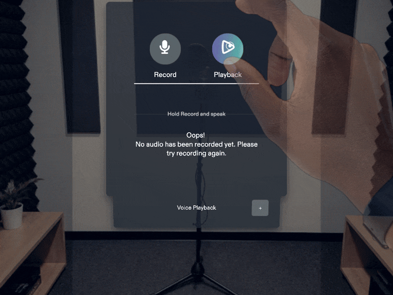
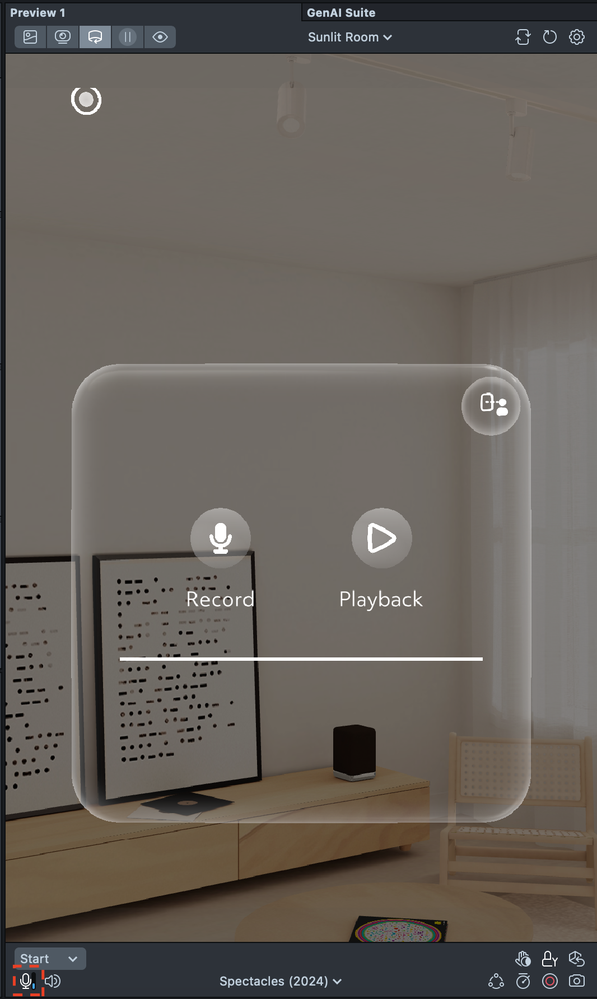

# Voice Playback

<!-- tags -->
    
<!-- /tags -->

## Overview

This sample project demonstrates how to record audio from the microphone of SPECS and play it back. Once the Lens is closed, the recordings you have made are no longer available. For more details on microphone access and audio features, refer to the [Lens Studio Audio documentation](https://developers.snap.com/lens-studio/features/audio/playing-audio).

> **NOTE**: This project will only work for the SPECS platform.

## Design Guidelines

Designing Lenses for SPECS offers all-new possibilities to rethink user interaction with digital spaces and the physical world.
Get started using our [Design Guidelines](https://developers.snap.com/spectacles/best-practices/design-for-spectacles/introduction-to-spatial-design)

## Prerequisites

- **Lens Studio**: v5.24+

**Note:** Ensure Lens Studio is [compatible with SPECS](https://ar.snap.com/download) for your SPECS device and OS versions.

- **SPECS OS Version**: v7.0+
- **SPECS App iOS**: v1.7+
- **SPECS App Android**: v1.7+

To update your SPECS device and mobile app, please refer to this [guide](https://support.spectacles.com/hc/en-us/articles/30214953982740-Updating).

You can download the latest version of Lens Studio from [here](https://ar.snap.com/download?lang=en-US).

## Getting Started

To obtain the project folder, clone the repository.

> **IMPORTANT:**
> This project uses Git Large Files Support (LFS). Downloading a zip file using the green button on GitHub **will not work**. You must clone the project with a version of git that has LFS.
> You can download Git LFS [here](https://git-lfs.github.com/).

## Initial Project Setup

The project should be pre-configured to get you started without any additional steps. However, if you encounter issues in the Logger Panel, please ensure your Lens Studio environment is set up for [SPECS](https://developers.snap.com/spectacles/get-started/start-buiding/preview-panel).

## Key Script

[MicrophoneRecorder.ts](./Assets/Scripts/MicrophoneRecorder.ts) - Controls the logic for recording microphone input, keeping it in memory, and playing back the recorded audio.

[ActivateMicrophoneRecorder.ts](./Assets/Scripts/ActivateMicrophoneRecorder.ts) - UI helper that listens for button press and release events to start and stop microphone recording.

[PlaybackMicrophoneRecorder.ts](./Assets/Scripts/PlaybackMicrophoneRecorder.ts) - UI helper that listens for button press events to trigger playback of the recorded audio.

## Testing the Lens

### In Lens Studio Editor

Make sure that you have enabled the live microphone input so that Lens Studio can get microphone data.

Once the Live Microphone Input is enabled, you can press and hold the "Record" button. The duration of the microphone recording is determined by how long you hold this button.

> **Warning:** Please be mindful of the size of the recording.

After you finish recording, press the "Playback" button once. If you have recorded audio, you can press this button as many times as you want to replay the recording.

### In SPECS Device

Use your right or left hand to pinch the "Record" button. Hold your pinch as long as you want to record.

Press the "Playback" button once you have recorded to get the audio playback.

The UI elements are under a Container Frame so you can move the UI frame as you like.

## Support

If you have any questions or need assistance, please don't hesitate to reach out. Our community is here to help, and you can connect with us and ask for support [here](https://www.reddit.com/r/Spectacles/). We look forward to hearing from you and are excited to assist you on your journey!

## Contributing

Feel free to provide improvements or suggestions or directly contributing via merge request. By sharing insights, you help everyone else build better Lenses.

---

 

​

​

​

​

---

*Built with 👽 by the SPECS team*
